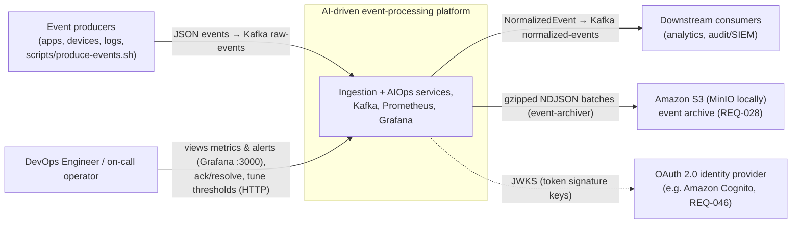
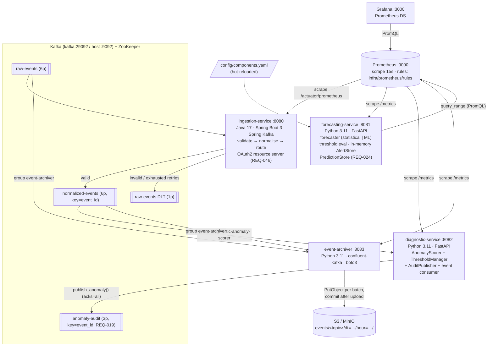
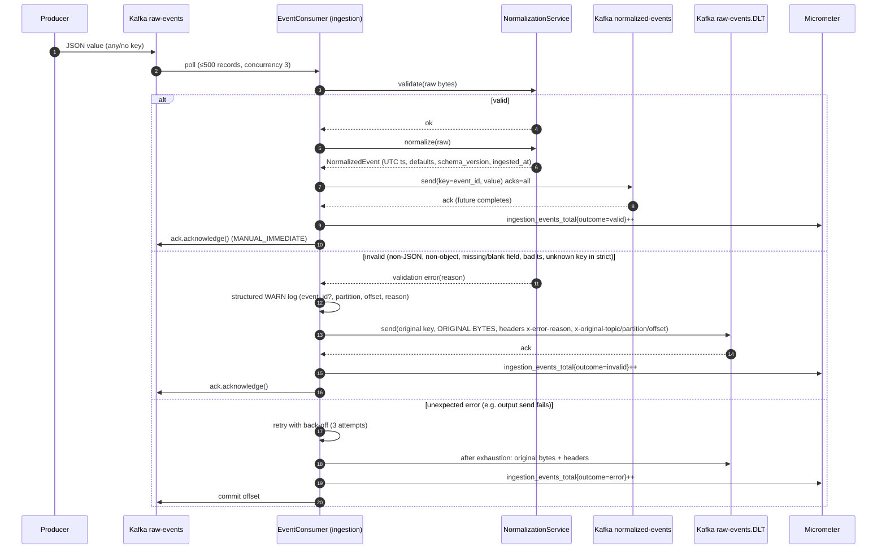
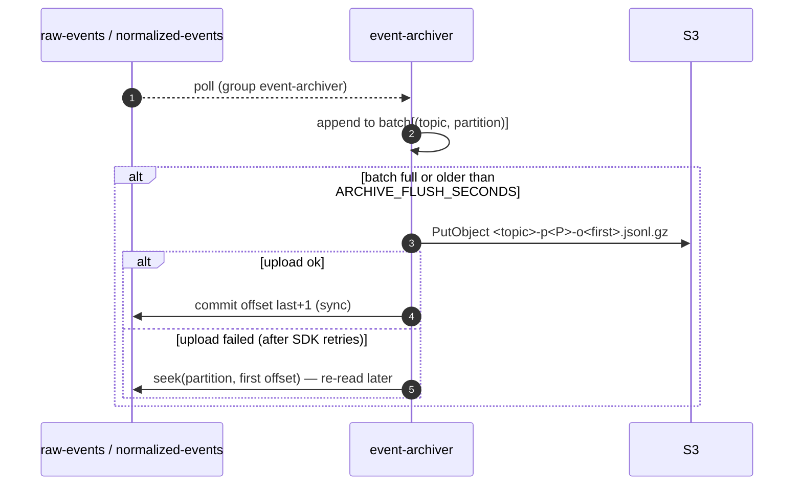

# Architecture

> Binding interfaces live in [`CONTRACTS.md`](CONTRACTS.md), and machine-readable schemas in [`../contracts/`](../contracts/). Decisions and their rationale are in [`adr/`](adr/README.md). This document describes how the pieces fit together and how they behave when something breaks. Where it adds detail, that detail is consistent with CONTRACTS.md. Items marked **(recommended)** are guidance that does not change any interface.

> **Updated for the finalized SRS** (`AI_Event_Processing_SRS_V2.pdf`, Version 1.0), the diagnostic-service rescoping (docs/adr/0008) and the S3 archiver (docs/adr/0009).

## 1. Scope and drivers

The platform has four independent paths:

| Path | Purpose | Requirements | Character |
|---|---|---|---|
| **Data path** | Ingest, validate and normalise high-volume events | REQ-001 to REQ-005, REQ-008, REQ-040 | Throughput-critical, at-least-once, Kafka-native, stateless |
| **Predictive analytics** | Forecast the platform's own metrics ahead of a threshold breach | REQ-021, REQ-022, REQ-025, REQ-052 | Low volume, latency-tolerant (seconds), ML-optional, must degrade gracefully |
| **Anomaly detection** | Score every event for anomalousness and record triggered anomalies | REQ-016 to REQ-020 | Per-event, low-latency, online baselines (docs/adr/0008) |
| **Archival** | Persist raw and normalized events to S3 | REQ-028 to REQ-030 | Batch, latency-tolerant, at-least-once, off the data path (docs/adr/0009) |

Main architectural drivers:

1. The data path must never depend on either AIOps path or on archival.
2. Predictive analytics and anomaly detection are **independent features with no hand-off between them** (SRS v1.0 §4.4 vs §4.5) — unlike the earlier design (ADR-0001, superseded), there is no forecasting → diagnostic coupling.
3. Predictive analytics must *always* produce an answer (statistical forecast) even when its ML components are missing.
4. The whole system must run on a laptop and pass CI with no GPU and no network.

## 2. System context (C4 level 1)



## 3. Containers (C4 level 2)



Note: `fc` (forecasting-service) and `dg` (diagnostic-service) have **no
edge between them** — this is deliberate (§1, driver 2). The earlier design
had `fc -- POST /diagnose/{component} --> dg`; that hand-off (ADR-0001) is
removed along with the GraphRAG/playbook design it fed (docs/adr/0008).

### Container responsibilities

| Container | Owns | Does **not** own |
|---|---|---|
| ingestion-service | Raw-event validation rules, normalisation, DLT routing, offset commits | Any AIOps concern. It only emits metrics. |
| forecasting-service | Metric retrieval, forecasting, thresholds (runtime-editable), `PredictiveAlert` lifecycle | Anomaly scoring, root-cause analysis |
| diagnostic-service | Anomaly scoring baselines, threshold evaluation, audit-topic publishing, model swaps | Alert lifecycle, forecasting, dependency-graph/LLM reasoning (Appendix C future work) |
| event-archiver | Kafka → S3 batching, offset commits after upload, archive layout | Retention (bucket lifecycle), IAM (Terraform) |
| Prometheus | Time-series storage, recording/alerting rules | Business state |
| Grafana | Presentation (REQ-034) | Any state (read-only over APIs) |

Internal structure of each Python service (**recommended**, ports and adapters only where a real substitution exists):

```
api (FastAPI routes) ──► domain (engine, models, severity rules) ──► ports
                                                                   ├─ MetricSource      → Prometheus adapter
                                                                   ├─ Forecaster        → statistical | ML            (ADR-0002)
                                                                   ├─ AlertStore        → in-memory                  (ADR-0007)
                                                                   ├─ AnomalyScorer     → ewma-zscore, swappable     (REQ-018)
                                                                   └─ AuditPublisher    → Kafka producer             (REQ-019)
```

Domain code (severity bands, lead-time gate) must not import FastAPI, httpx or tensorflow/scikit-learn directly in a way that breaks tests run without ML deps or network (CONTRACTS.md §6).

## 4. Domain model

| Concept | Owner | Identity | Lifecycle / invariants |
|---|---|---|---|
| RawEvent | producers | `event_id` (producer-assigned, not guaranteed unique) | Immutable. Valid or invalid. |
| NormalizedEvent | ingestion | `event_id` | Immutable. `timestamp` in UTC, `schema_version="1.0"`. |
| PredictiveAlert | forecasting | `al-<12hex>` | `open → acknowledged → resolved` (also `open → resolved`). At most one `open` per (component, metric). Emitted only if lead ≥ `ALERT_MIN_LEAD_MINUTES`. No longer carries a `playbook_id` (ADR-0001 superseded). |
| AnomalyScore | diagnostic | `event_id` (not its own identity) | Computed once per event in `[0, 1]`; anomalous iff `score > threshold`. Depends on the per-stream baseline at that moment (in memory per replica). |
| AnomalyAuditRecord | diagnostic | `audit_id` (UUID) | Immutable, one per anomaly, on `anomaly-audit`. |
| Prediction | forecasting | `prediction_id` (UUID) | Immutable, tagged with `model_version`; latest per (component, metric) served by the API, all appended to `PREDICTIONS_PATH`. |
| Archive object | event-archiver | `<topic>-p<partition>-o<first offset>` | Written once per batch; a replay overwrites the same key. Expired by lifecycle. |

`IncidentPlaybook` and the dependency node/edge model are retired — see docs/adr/0008. PredictiveAlert and AnomalyScore are unrelated models with no cross-reference between them (§1, driver 2).

## 5. Runtime views

### 5a. Event ingestion, including the DLT path (REQ-001, REQ-005, REQ-008)



Key properties:

- **At-least-once.** The offset is committed only after the downstream (output or DLT) send has been acknowledged. A crash between the send and the ack causes a redelivery, so `normalized-events` can contain duplicates. Consumers must de-duplicate on `event_id`.
- **Poison pills never block a partition.** They are dead-lettered and then acked.
- **DLT partitioning.** `raw-events.DLT` has **1** partition while `raw-events` has 6. Spring's `DeadLetterPublishingRecoverer` publishes to the *same partition number* by default, which would fail for records from partitions 1–5. The destination resolver therefore uses partition `-1` (the producer picks), as `KafkaConfig` does. The original partition is preserved in `x-original-partition`.
- **One DLT writer format.** Validation rejections (sent by the consumer) and exhausted retries (sent by the error handler's recoverer) both build their headers in `DeadLetters`, so DLT records look the same whichever path produced them.
- Spring's default `kafka_dlt-*` headers may also be present. The contract only requires the four `x-*` headers.

### 5b. Forecast → alert → dashboard (REQ-021, REQ-022, REQ-025, REQ-052)

```mermaid
sequenceDiagram
    autonumber
    participant L as Forecast loop (every FORECAST_INTERVAL_SECONDS)
    participant F as forecasting-service
    participant PR as Prometheus
    participant AS as AlertStore (in-memory)
    participant PS as PredictionStore
    participant GF as Grafana

    L->>F: forecast(component) for each configured component
    F->>PR: query_range(PromQL per metric, last FORECAST_WINDOW_MINUTES, PROMETHEUS_STEP)
    PR-->>F: series
    F->>F: forecaster.predict → point + p90 over horizon (statistical | ML)
    F->>F: confidence from p90 band width → low_confidence flag (REQ-025)
    F->>F: first t where p90 > threshold → lead = t - now
    alt breach and lead ≥ ALERT_MIN_LEAD_MINUTES and no OPEN alert for (component, metric)
        F->>F: severity from overshoot = (p90 - threshold)/threshold
        F->>AS: put(PredictiveAlert{status=open})
        F->>F: predictive_alerts_total{component,severity}++, predictive_alerts_open set
    else no breach / lead too short / already open
        F->>F: no alert (details explain why)
    end
    F->>PS: record(prediction, model_version) (REQ-024; served by GET /predictions)
    GF->>PR: predictive_alerts_open, predictive_alerts_total (scraped from F)
```

Notes:

- `POST /forecast` runs the same pipeline on demand and returns `{component_id, alert_emitted, alert, details}`.
- `PUT /thresholds/{component_id}` updates the in-memory thresholds, which the next cycle uses (REQ-052). `config/components.yaml` is re-read when its mtime changes. **Recommended precedence:** a file reload replaces only the file-sourced values, and API overrides stay until the process restarts (or until the ML Engineer documents another rule, see §10).
- There is no hand-off to diagnostic-service any more. An alert that breaches simply stays `open` until acknowledged/resolved; nothing downstream attempts root-cause analysis (that would be Appendix C GraphRAG future work, see docs/adr/0008).

### 5c. Anomaly detection (REQ-016 to REQ-020)

```mermaid
sequenceDiagram
    autonumber
    participant N as normalized-events (Kafka)
    participant D as diagnostic-service
    participant SC as AnomalyScorer
    participant TM as ThresholdManager
    participant AP as AuditPublisher
    participant AT as Kafka anomaly-audit topic

    N-->>D: event (consumer group diagnostic-anomaly-scorer; or POST /score/{event_id})
    D->>SC: score_event(event)
    SC-->>D: AnomalyScore(score, model_version)
    D->>TM: evaluate(score)
    alt score > threshold
        TM-->>D: anomalous
        D->>AP: publish_anomaly(event, score)
        AP->>AT: produce (REQ-019)
    else score <= threshold
        TM-->>D: not anomalous
    end
```

The consumer stores the offset after processing (at-least-once). An audit
publish failure is counted and logged but never blocks scoring. `PUT /model`
swaps the scorer by one reference assignment: in-flight calls finish on the
old model, new calls use the new one (REQ-018).

### 5d. Archival (REQ-028 to REQ-030, docs/adr/0009)



## 6. Quality attributes → acceptance criteria

| REQ | Acceptance criterion | Architectural tactic | How it is verified |
|---|---|---|---|
| REQ-001/004 | Accept concurrent producers, ack within 50ms, lag < 500 ms at 10 000 ev/s | 6 partitions × concurrency 3, batch poll 500, stateless consumer, HPA on ingestion. Lag via `kafka_consumer_fetch_manager_records_lag_max`. | Load test with `scripts/produce-events.sh` (Phase 5). The SLO and alert rule are in `docs/SLO.md` and `infra/prometheus/rules`. |
| REQ-005 | Malformed events rejected with structured logs and sent to the DLT | Validation before normalisation. DLT keeps original bytes plus reason headers. `outcome=invalid` counter. | Unit tests per invalid class. The integration test asserts a DLT record and its headers. |
| REQ-008 | All NormalizedEvent fields populated correctly | Pure mapping function, UTC conversion, explicit defaults | Unit tests checked against `contracts/normalized-event.schema.json` |
| REQ-021 | Forecast latency < 2 s for a 60-min window | Statistical forecaster by default (ADR-0002). Bounded window and step. `forecast_latency_seconds` histogram. | Unit timing test. `histogram_quantile(0.95, forecast_latency_seconds)` < 2 s. |
| REQ-025 | Alert ≥ 10 min before the predicted breach | p90 band, lead-time gate `ALERT_MIN_LEAD_MINUTES=10`, severity bands | Synthetic ramp series in tests: assert an alert with lead ≥ 10 and the correct severity |
| REQ-052 | Threshold change without redeploy | `PUT /thresholds` plus hot-reloaded `components.yaml` | Test: PUT, then the next forecast uses the new threshold |
| REQ-016 | Compute an anomaly score per event | `AnomalyScorer.score_event` + `normalized-events` consumer | Unit tests (range, warm-up, outliers, novelty); `anomaly_events_scored_total` |
| REQ-017 | Alert when score exceeds threshold | `ThresholdManager.evaluate` (strict `>`) | Boundary tests; API test flags a spike |
| REQ-018 | Swap models without downtime | `AnomalyDetector.swap_model`, `PUT /model` | Tests: warm/cold swap, API swap while serving |
| REQ-019 | Record anomalies to a Kafka audit topic | `AuditPublisher.publish_anomaly` | Tests validate records against `anomaly-audit.schema.json`; `AnomalyAuditPublishFailing` alert |
| REQ-020 | Runtime-adjustable detection threshold | `ThresholdManager.set_threshold`, `PUT /thresholds` | Tests incl. invalid values → 422 |
| REQ-023/024 | Query API; versioned, stored predictions | `PredictionStore`, `GET /predictions[/history]` | API + store tests |
| REQ-025 (confidence) | Flag low-confidence predictions | `band_confidence`, `PREDICTION_MIN_CONFIDENCE` | Tests: noisy series flagged, steady not |
| REQ-034 | New data visible ≤ 5 s | Grafana over Prometheus (15 s scrape; ADR-0006) | Manual/E2E: trigger an alert, time it to visible |
| REQ-028 to REQ-030 | Archive events to S3, retention, atomic writes | `event-archiver`, `ArchiveClient.archive_batch`, bucket lifecycle | Storage tests (commit-after-upload, rewind, deterministic keys); E2E against MinIO; `EventArchiveStalled` alert |
| REQ-046 | OAuth2 auth | `SecurityConfig.java`; `app/auth.py` (both Python services) | Tests: missing/expired/forged/wrong-audience tokens → 401 |
| REQ-047 | TLS 1.2+ | ALB ssl-policy (k8s Ingress), `server.ssl` (`SSL_ENABLED`), S3 `aws:SecureTransport` deny | Config review; needs a real certificate to test end-to-end |

Cross-cutting: **availability of the data path is independent of both AIOps paths.** Each service has `/health` (liveness: the process is up) and `/ready` (readiness: dependencies needed to serve are usable). **Recommended `/ready` semantics:** forecasting is ready once config has loaded (a Prometheus outage does not make it unready, see §7).

## 7. Failure modes and degradation

| Failure | Detected by | Behaviour | User-visible effect |
|---|---|---|---|
| **Prometheus down** | query errors. `forecast_runs_total{outcome="error"}` | Cycle for that component fails fast (bounded HTTP timeout). Loop continues. No alerts are created from missing data. Existing alerts are untouched. | No *new* predictive alerts. Metric panels are empty. The data path is unaffected. Self-monitoring is weak here because the metrics needed to notice the outage live in Prometheus itself, so check `up` from outside (Grafana's health check). |
| **Prometheus returns too little history** (new component, no exporter) | series shorter than the minimum | Treat as "insufficient data". Outcome `ok`, no alert, reason in `details`. | Component never alerts. See §10 on components without exporters. |
| **Kafka down** | consumer and producer errors, `/actuator/health` | Consumer keeps retrying the connection. Nothing is committed, so nothing is lost: on recovery, consumption resumes from the last committed offset. Producer sends fail, then retry, then error outcome. | Ingestion stalls and lag grows. The predictive-analytics path continues, and the stall should itself be predicted. |
| **Kafka up, output topic send fails** | send future exception | Retry 3× with back-off, then DLT (`outcome=error`), then ack | Event is preserved in the DLT for replay |
| **forecasting-service restart** | — | In-memory alerts lost (ADR-0007). Next cycle re-alerts with new ids. | Brief gap. Ack state is lost. |
| **Grafana down** | — | No effect on the services | No dashboard. The APIs remain usable. |
| **Kafka down (diagnostic-service)** | consumer errors, `anomaly_audit_publish_failures_total` | Consumer reconnects; `/score` keeps working; audit records fail after `message.timeout.ms` and are counted/logged. | `AnomalyAuditPublishFailing`. Anomalies still visible in logs and API responses. |
| **diagnostic-service restart** | — | In-memory baselines lost; each stream re-warms after 10 events. Consumer resumes from the committed offset. | Brief period without anomaly flags for each stream. |
| **S3 unavailable / AccessDenied** | `archive_failures_total`, `archive_last_success_timestamp_seconds` | Failed batch rewound and retried; offsets not committed; ingestion unaffected. | `EventArchiveUploadFailing`, then `EventArchiveStalled`. Archive lags; Kafka retention is the deadline. |

Design rule: **every outbound call has a timeout** (Prometheus; Kafka producer/consumer configs). The forecast loop isolates failures per component, so one bad component never stops the others.

(Rows for LLM outages, graph-DB outages and diagnostic-service hand-off failures are removed — those failure modes belonged to the retired GraphRAG/LLM/playbook design, docs/adr/0008.)

## 8. Scaling model

| Container | Scale unit | Ceiling / constraint | Notes |
|---|---|---|---|
| ingestion-service | pods in consumer group `ingestion-consumer-group` | ≤ 6 *useful* consumer threads per topic (6 partitions × concurrency 3 ⇒ 2 pods saturate them) | To scale beyond this, **increase `raw-events` partitions first**. The HPA range (2–6 pods) only helps once partitions ≥ pods × concurrency. Scale on lag (Phase 5), not CPU. |
| forecasting-service | **1 replica** (ADR-0007) | In-memory store, singleton loop | The HPA (1-5) must be capped at 1. Scale-out needs a shared store plus leader election. Vertical scaling suffices: about 24 series per cycle. |
| diagnostic-service | **2-6 pods, HPA on CPU** (docs/adr/0008) | ≤ 6 useful consumers (`normalized-events` partitions) | Each replica keeps its own baselines from a uniform sample of every stream (topic keyed by `event_id`). |
| event-archiver | pods in group `event-archiver` | ≤ 6 per topic (partitions) | S3 throughput is not the limit; batch size/flush interval trade object count against archive lag. |
| Prometheus | single | local TSDB | Standard. |
| Kafka | brokers / partitions | Single broker locally (RF=1) | Production: ≥ 3 brokers, RF=3, `min.insync.replicas=2` to give `acks=all` its meaning. |

Ordering: `normalized-events` is keyed by `event_id`, so per-producer order is **not** preserved across partitions. That is accepted: events carry their own timestamp.

## 9. Security notes

- **Trust boundary.** Everything inside the compose network or k8s namespace is trusted. At the edge: the ALB Ingress terminates TLS 1.2+ (REQ-047) and every non-ops API route requires a JWT validated against the IdP's JWKS (`iss`, `aud`, `exp`; REQ-046) once `OAUTH2_ENABLED=true` (ingestion: issuer/JWKS configured). Compose runs with auth off for local use. Phase 5: mTLS or a service mesh between services, and Grafana SSO.
- **Secrets.** None of the retired `LLM_API_KEY`/`GRAPH_DB_PASSWORD` secrets remain. The Grafana admin password should be set via env. S3 access on EKS uses IRSA (no static keys) with a write-only policy on `<bucket>/events/*`; the bucket blocks public access, enforces TLS, and is encrypted at rest.
- **Input size.** Raw events are untrusted. Kafka `max.message.bytes` bounds size. Strict validation limits top-level shape only, and `payload` is opaque.
- **Containers.** Non-root, read-only root filesystem where possible. diagnostic-service and event-archiver need no writable volume.

(Notes on LLM data egress, prompt injection, and playbook-path traversal are removed — they applied to the retired GraphRAG/LLM/playbook design, docs/adr/0008.)

## 10. Deliberate trade-offs and open points

Trade-offs taken (details in the ADRs):

| We chose | Over | Giving up |
|---|---|---|
| Statistical default (0002) | ML-only | Forecast accuracy on complex seasonality, until a TensorFlow/scikit-learn model is trained |
| Grafana (0006) | Custom UI | Rich interaction (ack buttons, custom layout) |
| In-memory alerts (0007) | Durable store | Restart durability, horizontal scale |
| Online EWMA z-score anomaly model (0008) | Offline-trained model / GraphRAG | Multivariate correlations; baselines reset on restart |
| Standalone archiver (0009) | Inline archival in ingestion / Kafka Connect | Archive lags by up to `ARCHIVE_FLUSH_SECONDS` |

(Rows for the HTTP hand-off, the networkx/Neo4j graph, the rule-based LLM fallback and the file-based playbook store are removed — those ADRs are superseded by 0008.)

Points the contract leaves open (implementers pick **consistent** behaviour and document it; none of them changes an interface):

1. **`predicted_value`** is the **peak** p90 value in the horizon (the value the severity is computed from); `predicted_breach_time` is the first crossing, or *now* when already breaching. Late breaches (lead < `ALERT_MIN_LEAD_MINUTES`) are still alerted. **Overshoot** = `(predicted_value − threshold) / threshold`. For `threshold == 0` (e.g. error rate), treat any breach as `critical` (or guard with `max(threshold, ε)`).
2. **"One OPEN alert per (component, metric)".** Recommended: an `acknowledged` alert also suppresses new ones until it is resolved. Otherwise acking an alert immediately causes a duplicate on the next cycle.
3. **Retry semantics** ("3 attempts"). The ingestion error handler implements it as 3 *retries* after the first delivery (`app.kafka.retry.max-retries: 3`, exponential back-off 500 ms → 5 s), so 4 deliveries in total. Never retry a 4xx (validation errors are dead-lettered immediately).
4. **Explicit `null` for optional raw fields** (`type`, `component_id`, `payload`). The schema rejects them as written. If ingestion chooses to treat `null` as absent, `contracts/raw-event.schema.json` must be widened together with an ADR.
5. **Monitored components without exporters.** `kafka` and `zookeeper` expose no CPU/memory/error-rate series in the current Prometheus config (the Kafka JMX job is commented out). `config/components.yaml` should either map them to metrics that exist (e.g. `up{job=…}`, or the ingestion lag metric for `kafka`) or mark them forecast-disabled.
6. ~~`AnomalyScore` semantics~~ — resolved: `[0, 1]`, higher = more anomalous, strict `>` at the threshold (CONTRACTS.md §3).
7. ~~Where `archive(record)` gets called from~~ — resolved by docs/adr/0009: a standalone `event-archiver` consumer.
